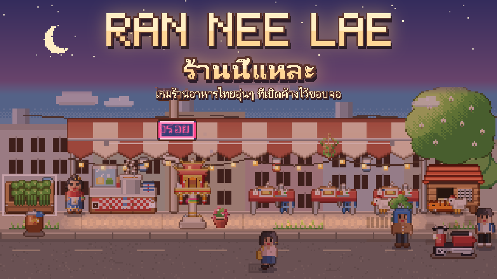

# ร้านนี้แหละ (Ran Nee Lae)

เกมร้านอาหารไทยแบบพิกเซล เปิดค้างไว้ที่ขอบหน้าจอได้ทั้งวัน เป็นเรื่องของป้าคนหนึ่งที่โรงอาหารปิดลง เหลือแค่ชามตราไก่ใบเก่าของแม่ ป้าเดินตามชามใบนั้นไปหาที่ทำกินใหม่ในซอยเล็กๆ แห่งหนึ่ง

ตอนนี้มีแค่ภาษาไทย และเล่นได้บน Windows 10/11 (64 บิต)

> **In English:** a cozy pixel Thai restaurant that stays open at the edge of your screen all day. Menus, buttons and the
> names of things can be English (Decor > Settings > Language); the story is still in Thai. [Download page in English](https://intity01.github.io/ran-nee-lae-releases/en/).

## ดาวน์โหลด

**[โหลดตัวติดตั้ง (Windows, ฟรี)](https://github.com/intity01/ran-nee-lae-releases/releases/latest/download/RanNeeLae-Setup.exe)** · หน้าเว็บของเกม: https://intity01.github.io/ran-nee-lae-releases/ · มีบน [itch.io](https://im-shines.itch.io/ran-nee-lae) ด้วย

หรือไปที่ [หน้ารีลีส](https://github.com/intity01/ran-nee-lae-releases/releases) แล้วเลือกหนึ่งไฟล์จากรุ่นบนสุด

| ไฟล์ | เหมาะกับ |
|---|---|
| `RanNeeLae-Setup-x.y.z.exe` | **คนส่วนใหญ่** ติดตั้งให้ มีไอคอนในเมนู Start และถอนออกได้จาก Settings |
| `RanNeeLae-x.y.z.zip` | คนที่ไม่อยากติดตั้ง แตกไฟล์แล้วดับเบิลคลิก `ran-nee-lae.exe` |

### ถ้า Windows ขึ้นว่า "Windows protected your PC"

เกมนี้ไม่มีลายเซ็นดิจิทัล (ต้องซื้อรายปี) Windows จึงเตือนในครั้งแรก ให้กด **More info** แล้วกด **Run anyway** ครั้งต่อไปจะไม่เตือนอีก
ถ้าอยากตรวจว่าไฟล์ไม่ถูกแก้ไข ให้เทียบค่า SHA-256 กับ `SHA256SUMS.txt` ในหน้ารีลีส

## อัปเดต

ตอนเปิด เกมจะเช็กว่ามีอัปเดตไหม ถ้ามีจะขึ้นปุ่ม "โหลดอัปเดต" ใต้แถบบน ไฟล์อัปเดตมีขนาดเล็ก และเกมตรวจลายเซ็นทุกครั้งก่อนใช้ อัปเดตจะมีผลตอนเปิดเกมครั้งถัดไป ถ้าไม่อยากให้เกมเช็กอัปเดต ปิดได้ในหน้าตั้งค่า

## ลบเกม

- **ติดตั้งด้วยตัวติดตั้ง:** ไปที่ Settings > Apps > ร้านนี้แหละ > Uninstall ระบบจะถามว่าจะลบเซฟด้วยไหม ถ้าตอบไม่ลบ ติดตั้งใหม่เมื่อไรก็เล่นต่อจากเดิมได้
- **ใช้แบบ zip:** ลบโฟลเดอร์เกมทิ้ง ถ้าอยากลบเซฟด้วย ให้ลบโฟลเดอร์ `%APPDATA%\Godot\app_userdata\ร้านนี้แหละ (overlay prototype)\`

## สัญญาอนุญาต

เล่นฟรี และถ่ายคลิปหรือสตรีมได้ แต่ห้ามขายหรือแจกไฟล์เกมจากที่อื่น ดูรายละเอียดใน [LICENSE.txt](LICENSE.txt)
เกมนี้สร้างด้วย [Godot Engine](https://godotengine.org)
